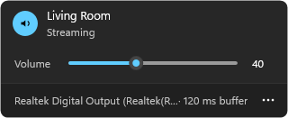

# Airtight

<p align="center"></p>
<p align="center"><b>Stream what your computer plays to a HomePod, over AirPlay 2.</b><br>
A native app in Rust, for Windows and Linux. Works with HomePodOS 27.</p>

## Install

### Windows 10 and 11

[**Download airtight.exe**](https://github.com/JTCHE/airtight/releases/latest/download/airtight.exe) and run it. Airtight goes to the tray and starts with Windows.

> [!NOTE]
> The exe is not signed yet, so Windows shows "Windows protected your PC". Select **More info**, then **Run anyway**. Windows Firewall then asks for network access: allow it on private networks.

### Linux

You need [Rust](https://rustup.rs), PulseAudio or PipeWire, and systemd.

```sh
git clone https://github.com/JTCHE/airtight && cd airtight && ./install.sh
```

The script builds Airtight, asks for the receiver, and runs it as a user service. `sudo` asks once, because the PTP clock needs UDP ports 319 and 320. Install `playerctl` to show the track on the receiver.

## Use

### Windows
Click the tray icon, then click a receiver. Click it again to stop. The **⋯** menu sets the output to capture, the buffer, and when to connect.

### Linux

```sh
airtight --list               # find the receivers
airtight --use "Living Room"  # stream to this one
systemctl --user restart airtight
```

The receiver shows the track, the cover and the position. Its play, pause, next and previous controls go to the player on the computer.

<details>
<summary><b>Build on Windows</b></summary>

You need [Rust](https://rustup.rs) with the MSVC toolchain.

```powershell
powershell -ExecutionPolicy Bypass -File install.ps1
```

The script builds the release exe, stops the running copy, installs to `%LOCALAPPDATA%\Programs\Airtight`, adds a Start menu shortcut and starts the app. The firewall rule stays valid for each new build, because the path does not change.

`cargo test --workspace` runs the tests. `cargo test -p airtight-hygiene` checks the code rules in [AGENTS.md](AGENTS.md).

</details>

<details>
<summary><b>How it works</b></summary>

- HomePodOS 27 accepts only PTP timing. Senders that use NTP timing stopped working with that update. Airtight runs its own PTP grandmaster clock, and the receiver plays on that clock.
- Airtight owns its protocol code: SRP and HAP pairing, ChaCha20-Poly1305, binary plist, mDNS, ALAC, PTP, RTSP and the MediaRemote messages for Now Playing. The only outside crate is [`windows`](https://github.com/microsoft/windows-rs), on Windows only.
- Capture: event-driven WASAPI loopback on Windows. The monitor source of a sink on Linux, through `libpulse-simple`, which Airtight loads at run time.
- Now Playing: the system media session on Windows. MPRIS through `playerctl` on Linux.
- A dropped session reconnects after 2, 5, 10, 20 and 30 s. After the second failure, Airtight searches the network again, in case the receiver has a new address.

</details>

<details>
<summary><b>Troubleshooting</b></summary>

- **Log:** `%APPDATA%\Airtight\session.log` on Windows, `~/.config/airtight/session.log` on Linux. `[CAPTURE]` lines point to a local cause (CPU load, power settings). `[AIRPLAY]` and `[LINK]` lines point to the network or the receiver. `[STREAM] … late=N` counts packets that the receiver lost and asked for again too late: N above 0 is a gap you hear, caused by the receiver's Wi-Fi.
- **You hear the sound twice:** capture an output that you do not listen to, for example a digital output with nothing connected.
- **"Another program uses the PTP ports":** another AirPlay 2 sender runs. Stop it.
- **No receivers found on Linux:** a firewall that blocks inbound traffic also blocks the mDNS replies. Allow the local network.
- **Test a receiver without the UI:** `airtight --probe <receiver ip> 8` plays for 8 s, then stops.

</details>

## License

[MIT](LICENSE)
